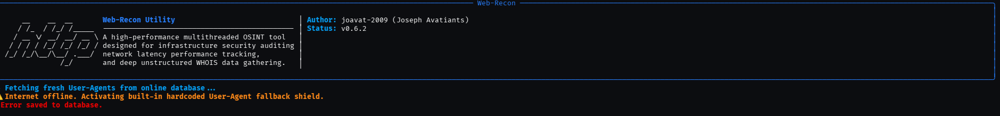
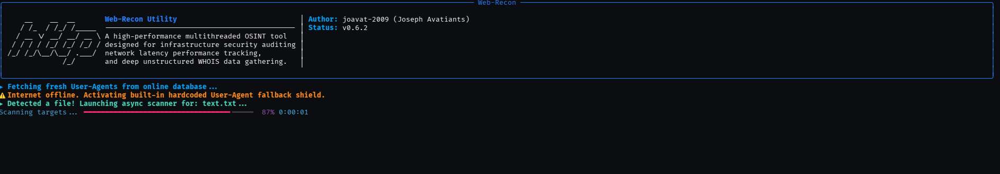
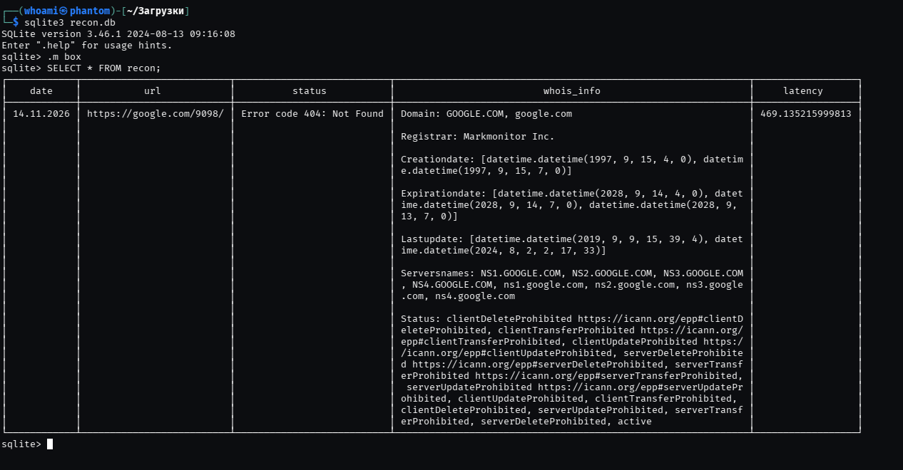

# Web Recon & Domain Intelligence Tool 
<p align="right">
  <a href="README.md"><b>🇬🇧 English</b></a> | 
  <a href="README.ru.md"><b>🇷🇺 Русский</b></a>
</p>


<p align="center">
  
</p>

[](#) [](#) [](#) [](#)

---

**Web-Recon** is a high-performance, production-grade asynchronous CLI/TUI utility engineered for passive reconnaissance (OSINT), mass network perimeter auditing, and deep infrastructure health tracking.

Unlike traditional, rigid brute-forcers or simple domain checkers, `Web-Recon` bridges the gap between reactive asynchronous scanning speeds and multi-dimensional OSINT data enrichment in a single execution pipeline. Upon detecting any network anomaly (such as connection drops, DNS failures, timeouts, or non-200 HTTP response codes), the utility instantly spawns non-blocking background workers. These workers retrieve full WHOIS registration profiles, including registrar metadata, creation/expiration timelines, and active name servers, immediately packaging structured outputs into an atomic SQLite relational database.

---

## Visual Preview

<p align="center">
  
</p>

<p align="center">
  
</p>

<p align="center">
  
</p>

---

##  Core Architectural Features

* **Reactive Async Core (`asyncio` + `aiohttp`):** Orchestrates massive non-blocking request bursts through a single persistent `ClientSession` pipeline, bypassing heavy OS-level thread overhead. It leverages native response reason parsing to capture precise server-side execution context without bloated conditional statements.
* **Dynamic Identity Evasion Matrix (New in v0.6.2):** Implements a multi-tiered sequential identity cascading loader to completely scramble scanner profiling against Web Application Firewalls (WAF) and active anti-bot systems. Every parallel request spawned within the loop picks an isolated, random browser string signature, mimicking distributed live organic user traffic.
* **Asynchronous Storage Sink (`aiosqlite`):** Delivers concurrent data persistence and dynamic runtime database schema mapping without causing Event Loop degradation or freezing the terminal layout. Table names are dynamically isolated inside strict `[]` SQL brackets to ensure complete structural query validation.
* **Thread-Isolated WHOIS Engine (`asyncio.to_thread`):** Smoothly offloads blocking synchronous network operations (Port 43 socket connections) onto native background thread scopes. This guarantees that sluggish or air-gapped domain lookups never block the main loop or interrupt the fluid TUI frame rendering.
* **Advanced Concurrency Control (Rate Limiting):** Implements fine-grained hardware task capping via an `asyncio.Semaphore` flag (`-c`) combined with configurable "Stealth Delays" (`-d`). This allows operators to audit infrastructure meticulously without generating accidental Denial-of-Service (DoS) footprints or triggering Web Application Firewall (WAF) blocks.
* **Headless Automation Mode (`--quiet`):** Provides a comprehensive automated scripting flag (`-q`) that completely suppresses all ANSI screen clear operations, ASCII artwork, split-panels, and progressive layout monitors. This enables seamless, silent integration inside headless bash pipelines and automated cron jobs.
* **Rigid CLI Parameter Binding (`argparse`):** Restructures runtime setup using standardized option parsing. It enforces configuration integrity by binding target URL inputs and list files inside a mutually exclusive parameter group.

---

##  Identity Cascading Logic (User-Agent Fallback Architecture)

When evaluating target perimeter nodes, `Web-Recon` enforces a 3-tier fallback matrix to ensure browser headers are always authentic, stealthy, and un-profiled:
1. **Tier 1 (Programmatic File):** If the custom flag `-A` is assigned, the engine strictly loads, isolates, and parses the localized text file provided by the operator.
2. **Tier 2 (Remote Live Repository Feed):** If no file is parsed, the engine attempts a non-blocking stream fetch against high-availability remote text databases to extract the latest rolling desktop stable signatures.
3. **Tier 3 (Embedded Fallback Shield):** In isolated air-gapped forensic laboratories, the application smoothly deploys an internal immutable array of standard high-grade Chrome, Safari, Edge, and Firefox signatures to ensure operational continuity.

---

##  CLI Flags & Usage Manual

### Options Matrix

| Flag | Long Option | Data Type | Default | Description |
| :--- | :--- | :---: | :---: | :--- |
| `-t` | `--target` | `string` | *None* | Target a single URL for immediate individual audit. |
| `-f` | `--file` | `string` | *None* | Path to a `.txt` target list for bulk asynchronous exploration. |
| `-o` | `--output` | `string` | `RReport` | Custom SQLite database and synchronized table filename. |
| `-c` | `--concurrency`| `integer` | `50` | Maximum number of simultaneous network requests. |
| `-d` | `--delay` | `float` | `0.5` | Stealth delay time in seconds between parallel checks. |
| `-A` | `--UserAgents` | `string` | *None* | Optional custom flat-file path loaded with active browser headers. |
| `-q` | `--quiet` | `flag` | `False` | Triggers Headless Silent Mode (kills all UI and drawings). |

### Practical Execution Examples

```bash
# Display the built-in technical manual and options layout
web-recon --help

# Run a standard mass async scan with the dynamic online User-Agent rotation active
web-recon -f ./sites/targets.txt -o CorporateAudit

# Inject custom parsed browser profiles list while capping concurrency and stealth delay limits
web-recon -f ./sites/targets.txt -o EvadingAudit -c 5 -d 1.5 -A ./my_stealth_agents.txt

# Audit a single isolated target infrastructure
web-recon -t https://linode.com -o OnDemandCheck

# Headless execution mode for background bash scripting pipelines
web-recon -f ./sites/targets.txt -o AutomatedLog --quiet
```

---

##  Security & SAST Audit Results

The application's source code has been audited via the **Bandit SAST Scanner** (Static Application Security Testing) against strict production security metrics.

* **Scan Result:** `No issues identified`
* **Metrics:** 0 Low, 0 Medium, 0 High severity flaws discovered.
* **Compliance:** Zero hardcoded credential leaks, zero unhandled execution paths, and zero unsanitized shell exposures.

---

##  Author
- **Joseph Avatyants**
- GitHub: [@joavat-2009](https://github.com)
- Email: joavat2009@gmail.com
