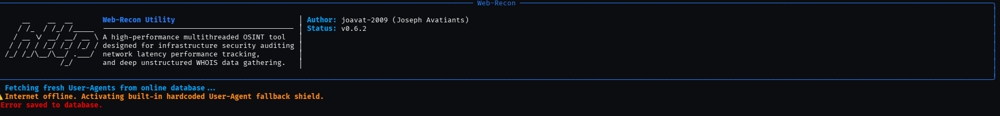
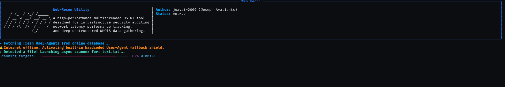
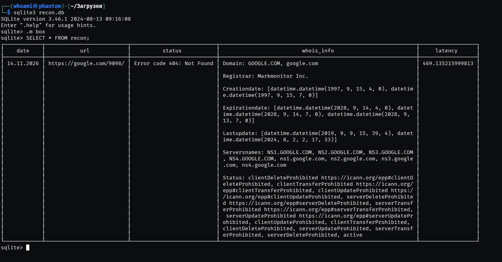
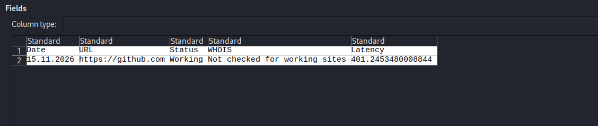

# Инструмент веб-разведки и анализа доменов
<p align="right">
  <a href="README.md"><b>🇬🇧 English</b></a> | 
  <a href="README.ru.md"><b>🇷🇺 Русский</b></a>
</p>


<p align="center">
  
</p>

[](#) [](#) [](#) [](#)

---

**Web-Recon** — это высокопроизводительная асинхронная CLI/TUI-утилита производственного уровня, предназначенная для пассивной разведки (OSINT), массового аудита сетевого периметра и глубокого отслеживания состояния инфраструктуры.

В отличие от традиционных жёстких брутфорсеров или простых чекеров доменов, `Web-Recon` сокращает разрыв между скоростью реактивного асинхронного сканирования и многомерным обогащением OSINT-данными в едином конвейере выполнения. При обнаружении любой сетевой аномалии (обрыв соединения, сбой DNS, таймаут или HTTP-код, отличный от 200) утилита мгновенно порождает неблокирующие фоновые обработчики. Эти обработчики извлекают полные WHOIS-профили регистрации, включая метаданные регистратора, даты создания и истечения, а также активные серверы имён, и сразу упаковывают структурированный результат в атомарную реляционную базу SQLite.

Утилита также поддерживает **профилирование сетевой задержки в реальном времени** — каждый запрос замеряется с точностью `time.perf_counter()`, а измеренное время приёма-передачи (в миллисекундах) сохраняется вместе со статусом цели и WHOIS-паспортом. Это позволяет операторам замечать деградацию инфраструктуры ещё до того, как она превратится в полный сбой, а не только постфактум.

---

## Визуальный обзор

<p align="center">
  
</p>

<p align="center">
  
</p>

<p align="center">
  
</p>

<p align="center">
  
</p>

---

##  Ключевые архитектурные особенности

* **Реактивное асинхронное ядро (`asyncio` + `aiohttp`):** Организует массовые неблокирующие всплески запросов через единый постоянный конвейер `ClientSession`, обходя тяжёлые накладные расходы ОС-уровня на потоки. Использует нативный разбор причины ответа для точного захвата серверного контекста выполнения без раздутых условных конструкций.
* **Динамическая матрица уклонения идентичности:** Реализует многоуровневый каскадный загрузчик идентичностей для полного запутывания профилирования сканера против Web Application Firewall (WAF) и активных анти-бот систем. Каждый параллельный запрос, порождённый в цикле, выбирает изолированную случайную сигнатуру браузера, имитируя распределённый живой органический трафик пользователей.
* **Асинхронный приёмник данных (`aiosqlite`):** Обеспечивает конкурентную персистентность данных и динамическое отображение схемы БД во время выполнения без деградации Event Loop и заморозки терминальной раскладки. Имена таблиц динамически изолируются внутри строгих SQL-скобок `[]` для полной структурной валидации запросов.
* **Потоково-изолированный WHOIS-движок (`asyncio.to_thread`):** Плавно выгружает блокирующие синхронные сетевые операции (сокетные соединения порта 43) в нативные фоновые области потоков. Это гарантирует, что медленные или изолированные от сети поиски доменов никогда не блокируют главный цикл и не прерывают плавный рендеринг кадров TUI.
* **Точное профилирование задержки:** Каждый отдельный запрос обёрнут в высокоточный таймер `time.perf_counter()`. Измеренная круговая задержка (в миллисекундах) сохраняется прямо в базу данных вместе со статусом цели и WHOIS-метаданными, что позволяет проводить тонкий анализ трендов производительности и проверку SLA по всему аудируемому периметру.
* **Продвинутый контроль конкурентности (Rate Limiting):** Реализует тонкое ограничение задач через флаг `asyncio.Semaphore` (`-c`) в сочетании с настраиваемыми «Stealth-задержками» (`-d`). Это позволяет операторам тщательно аудировать инфраструктуру, не создавая случайных следов Denial-of-Service (DoS) и не провоцируя блокировки Web Application Firewall (WAF).
* **Режим безголовой автоматизации (`--quiet`):** Предоставляет комплексный флаг автоматизированного скриптинга (`-q`), который полностью подавляет все ANSI-операции очистки экрана, ASCII-арт, сплит-панели и мониторы прогрессивной раскладки. Это обеспечивает бесшовную бесшумную интеграцию в безголовые bash-конвейеры и автоматизированные cron-задачи.
* **Экспорт отчёта в CSV (`--csv`):** Флаг одной строки (`-cT`) выгружает полные результаты сканирования из памяти в CSV-файл с разделителем-точкой с запятой и UTF-8-BOM с колонками `Date; URL; Status; WHOIS; Latency`. Идеально подходит для последующего импорта в Excel, SIEM или BI-дашборды.
* **Жёсткая привязка CLI-параметров (`argparse`):** Перестраивает конфигурацию во время выполнения с помощью стандартизированного разбора опций. Обеспечивает целостность конфигурации, привязывая входные данные целевого URL и файлы списков внутри взаимоисключающей группы параметров.

---

##  Логика каскада идентичностей (архитектура fallback User-Agent)

При оценке узлов целевого периметра `Web-Recon` применяет 3-уровневую матрицу fallback, чтобы гарантировать, что заголовки браузера всегда аутентичны, скрытны и не профилированы:
1. **Уровень 1 (Программный файл):** Если назначен пользовательский флаг `-A`, движок строго загружает, изолирует и разбирает локализованный текстовый файл, предоставленный оператором.
2. **Уровень 2 (Удалённый живой фид репозитория):** Если файл не разобран, движок пытается выполнить неблокирующую потоковую выборку из высокодоступных удалённых текстовых баз данных для извлечения последних актуальных десктопных стабильных сигнатур.
3. **Уровень 3 (Встроенный щит fallback):** В изолированных криминалистических лабораториях без доступа к сети приложение плавно разворачивает внутренний неизменяемый массив стандартных высококлассных сигнатур Chrome, Safari, Edge и Firefox для обеспечения непрерывности работы.

---

##  Конвейер обработки данных во время выполнения

Каждая сканируемая цель проходит через детерминированный неблокирующий конвейер:

1. **Валидация** — URL должен начинаться с `http://` или `https://`, иначе выдаётся предупреждение.
2. **Инъекция идентичности** — для запроса из загруженного пула выбирается случайный User-Agent.
3. **Замеряемый запрос** — цель опрашивается внутри защиты `asyncio.Semaphore`; `perf_counter()` обрамляет вызов для получения значения задержки с точностью до миллисекунд.
4. **Разрешение статуса** — HTTP `200` логируется как `Working`; любой другой код фиксируется как `Error code <N>: <reason>`; сбои соединения помечаются как *Site is completely down or domain is invalid*.
5. **WHOIS-обогащение** — только для **неработающих** целей потоково-изолированный WHOIS-поиск заполняет поле паспорта (работающие сайты намеренно пропускаются для экономии квоты запросов и избежания шума).
6. **Персистентность** — строка `(date, url, status, whois_info, latency)` атомарно фиксируется в таблице SQLite.

---

## Установка

### Требования

- Python 3.11+
- Linux / macOS (Windows через WSL должен работать, но официально не тестировался)

### Установка из исходников (рекомендуется)

Проект пока не опубликован на PyPI, поэтому ставим из репозитория:

```bash
git clone https://github.com/joavat-2009/Web-Recon.git
cd Web-Recon
pipx install .
```

---

##  CLI-флаги и руководство по использованию

### Матрица опций

| Флаг | Длинная опция | Тип данных | По умолчанию | Описание |
| :--- | :--- | :---: | :---: | :--- |
| `-t` | `--target` | `string` | *Нет* | Аудит одной цели по URL для немедленной индивидуальной проверки. |
| `-f` | `--file` | `string` | *Нет* | Путь к `.txt`-списку целей для массового асинхронного исследования. |
| `-o` | `--output` | `string` | `RReport` | Пользовательское имя файла базы SQLite и синхронизированной таблицы. |
| `-c` | `--concurrency`| `integer` | `50` | Максимальное количество одновременных сетевых запросов. |
| `-d` | `--delay` | `float` | `0.5` | Stealth-задержка в секундах между параллельными проверками. |
| `-A` | `--UserAgents` | `string` | *Нет* | Необязательный путь к пользовательскому плоскому файлу с активными заголовками браузера. |
| `-q` | `--quiet` | `flag` | `False` | Активирует режим безголовой тишины (отключает весь UI и отрисовку). |
| `-cT`| `--csv` | `flag` | `False` | Экспорт финальных результатов сканирования в CSV-отчёт с разделителем `;`. |

---

### Практические примеры выполнения

```bash
# Показать встроенное техническое руководство и раскладку опций
web-recon --help

# Запустить стандартное массовое асинхронное сканирование с активной динамической онлайн-ротацией User-Agent
web-recon -f ./sites/targets.txt -o CorporateAudit

# Внедрить пользовательский список разобранных браузерных профилей с ограничением конкурентности и stealth-задержки
web-recon -f ./sites/targets.txt -o EvadingAudit -c 5 -d 1.5 -A ./my_stealth_agents.txt

# Аудит инфраструктуры одной изолированной цели
web-recon -t https://linode.com -o OnDemandCheck

# Режим безголового выполнения для фоновых bash-конвейеров скриптинга
web-recon -f ./sites/targets.txt -o AutomatedLog --quiet

# Экспорт последнего сканирования в CSV-отчёт для Excel / SIEM
web-recon -f ./sites/targets.txt -o CorporateAudit -cT
```
---

##  Выходные артефакты

| Артефакт | Формат | Содержимое |
| :--- | :--- | :--- |
| `<output>.db` | SQLite 3 | Таблица `<output>` с колонками `date`, `url`, `status`, `whois_info`, `latency`. |
| `<output>.csv` | CSV (UTF-8-BOM, разделитель `;`) | Зеркалирует те же колонки для потребления в таблицах/BI. Генерируется только при передаче `-cT`. |

---

##  Результаты аудита безопасности и SAST

Исходный код приложения был проаудирован сканером **Bandit SAST** (Static Application Security Testing) на соответствие строгим производственным метрикам безопасности.

* **Результат сканирования:** `Проблем не выявлено`
* **Метрики:** 0 уязвимостей низкой, 0 средней и 0 высокой критичности.
* **Соответствие:** Ноль утечек жёстко закодированных учётных данных, ноль необработанных путей выполнения и ноль несанитизированных оболочечных уязвимостей.

---

##  Автор
- **Иосиф Аватьянц (Joseph Avatyants)**
- GitHub: [@joavat-2009](https://github.com)
- Email: joavat2009@gmail.com
